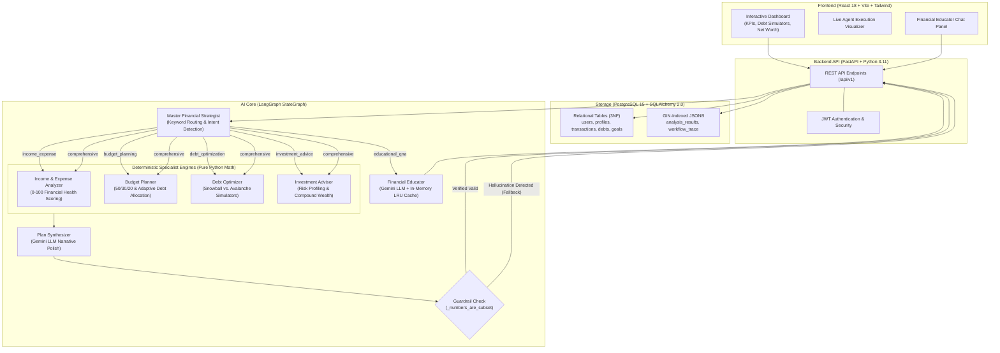

<div align="center">

# 🏦 FinWise — Multi-Agent AI Personal Finance Advisor

<p align="center">
  <strong>Deterministic financial precision meets intelligent narrative synthesis.</strong><br>
  Built with LangGraph, FastAPI, PostgreSQL, and React 18.
</p>

[](https://www.python.org/)
[](https://fastapi.tiangolo.com)
[](https://langchain-ai.github.io/langgraph/)
[](https://www.postgresql.org/)
[](https://react.dev/)
[](https://www.typescriptlang.org/)
[](https://tailwindcss.com/)
[](https://opensource.org/licenses/MIT)

</div>

---

## 📌 Overview

**FinWise** is an open-source, multi-agent personal finance advisory platform designed to solve the critical problem of LLM hallucinations in consumer finance. 

Traditional AI assistants often hallucinate interest calculations, miscalculate debt payoff timelines, and invent financial figures. **FinWise prevents this through a hybrid deterministic-AI architecture:**

1. **Zero-LLM Fast Routing:** An intent router uses regex pattern matching to categorize requests in $<1\text{ ms}$ with zero API cost.
2. **Pure Python Specialist Engines:** Debt payoff schedules (Snowball vs. Avalanche), 50/30/20 budgets, and financial health scores are calculated exclusively through exact algebraic formulas.
3. **Controlled LLM Synthesis:** Google Gemini formats the calculated results into clear, actionable prose.
4. **Numeric Subset Guardrail:** A strict validation check (`_numbers_are_subset`) compares the LLM's narrative against the deterministic source data. If any new or altered number is detected, the LLM output is rejected and replaced with the verified deterministic report.

---

## 🏗️ Architecture



---

## ✨ Features

- 🧠 **Council of Specialized AI Agents:** Dedicated specialist modules for cash flow analysis, 50/30/20 budgeting, dual-strategy debt payoff, investment risk profiling, and educational Q&A.
- 🛡️ **Anti-Hallucination Numeric Guardrail:** Enforces `_numbers_are_subset` comparison on synthesized responses to guarantee mathematical accuracy.
- 📉 **Dual Debt Payoff Amortization:** Calculates exact month-by-month payoff curves comparing the **Snowball method** (smallest balance first) against the **Avalanche method** (highest APR first), displaying total interest saved.
- 🎯 **Dynamic 0–100 Financial Health Score:** Assesses income stability, savings rate, fixed-to-discretionary expense ratios, and cash flow anomalies on an objective 100-point index.
- ⚡ **Zero-LLM Cost-Saving Routing:** Routes incoming requests using keyword and pattern analysis in $<1\text{ ms}$ without incurring LLM latency or token fees.
- 🕒 **In-Memory Concept Cache:** Caches financial educational explanations (LRU cache with 30-minute TTL) for sub-millisecond retrieval.
- 🔍 **Visual Workflow Execution Trace:** Renders per-agent execution times, latencies, and statuses directly on the UI dashboard.

---

## 📸 Screenshots & UI Preview

| View | Description |
|---|---|
| **Executive Dashboard** | *KPI summary cards displaying Net Cash Flow, Savings Rate, Emergency Buffer Runway, and 0–100 Health Score.* |
| **Debt Payoff Engine** | *Interactive Recharts visualization comparing month-by-month principal reduction curves for Snowball vs. Avalanche strategies.* |
| **Multi-Agent Pipeline Visualizer** | *Live execution tracker displaying timestamps, status badges, and latencies for each specialist node in the LangGraph workflow.* |
| **Financial Educator Chat** | *Conversational panel offering conceptual financial explanations (definitions, importance, and practical examples) with zero calculation hallucinations.* |

---

## ⚡ Quick Start

### Prerequisites
- **Python 3.11+**
- **Node.js 18+** & **npm**
- **PostgreSQL 15+**
- **Google Gemini API Key** ([Get your key here](https://aistudio.google.com/))

### Get Running in 5 Commands

```bash
# 1. Clone the repository
git clone https://github.com/your-username/finwise.git && cd finwise

# 2. Set up and start PostgreSQL database
createdb finwise_db

# 3. Configure and start backend (in a new terminal)
cd backend && python3.11 -m venv venv && source venv/bin/activate
pip install -r requirements.txt
cp .env.example .env # Add your GEMINI_API_KEY and DATABASE_URL
alembic upgrade head && uvicorn main:app --reload --port 8000

# 4. Configure and start frontend (in a new terminal)
cd ../frontend && npm install
npm run dev

# 5. Open your browser at http://localhost:5173
```

---

## 📁 Project Structure

```
finwise/
├── backend/
│   ├── main.py                  # FastAPI application & route registration
│   ├── config.py                # Pydantic settings & environment configuration
│   ├── database.py              # PostgreSQL engine & SQLAlchemy session factory
│   ├── models.py                # 7 core SQLAlchemy ORM models
│   ├── auth.py                  # JWT authentication & password hashing (bcrypt)
│   ├── schemas.py               # Pydantic v2 validation schemas
│   ├── graph/
│   │   ├── state.py             # AgentState TypedDict & AnalysisType enum
│   │   └── workflow.py          # LangGraph StateGraph topology & conditional edges
│   ├── agents/
│   │   ├── master_agent.py      # Intent routing, plan synthesis, numeric guardrail
│   │   ├── budget_planner.py    # 50/30/20 & debt-adaptive budget allocation
│   │   ├── debt_optimizer.py    # Snowball vs. Avalanche amortization engines
│   │   ├── income_analyzer.py   # Spending trends & 0-100 financial health score
│   │   ├── investment_advisor.py# Asset allocation & compound return projections
│   │   └── financial_educator.py# Concept Q&A with Gemini LLM & in-memory cache
│   ├── tools/
│   │   ├── calculators.py       # Pure Python mathematical financial formulas
│   │   └── plan_builder.py      # Assembles specialist outputs into markdown plans
│   └── data/
│       └── sample_profile.json  # Mock financial data for quick testing
├── frontend/
│   ├── src/
│   │   ├── App.tsx              # Router, ThemeProvider, and AuthProvider
│   │   ├── pages/
│   │   │   ├── Dashboard.tsx    # Main interactive advisory dashboard
│   │   │   └── Login.tsx        # Authentication & registration page
│   │   ├── components/
│   │   │   ├── AgentFlowDiagram.tsx # Real-time agent execution pipeline
│   │   │   ├── DebtVisualizer.tsx   # Recharts Snowball vs. Avalanche charts
│   │   │   ├── MetricsOverview.tsx  # KPI summary cards
│   │   │   ├── ProfileForm.tsx      # Financial profile configuration form
│   │   │   ├── ResultsPanel.tsx     # Markdown plan viewer
│   │   │   └── ChatPanel.tsx        # Educational conversational assistant
│   │   ├── hooks/
│   │   │   ├── useAuth.ts       # Authentication state hook
│   │   │   └── useAnalysis.ts   # LangGraph analysis trigger & polling hook
│   │   └── lib/
│   │       └── api.ts           # Axios / Fetch client abstraction
│   ├── package.json
│   ├── tailwind.config.js
│   └── vite.config.ts
├── docs/
│   └── database_design_architecture.md # Complete PostgreSQL & schema document
├── PROJECT_COMPLETE_GUIDE.md    # Master architecture guide & interview prep
└── README.md
```

---

## 🔌 API Reference Summary

| Method | Endpoint | Description | Auth Required |
|---|---|---|---|
| `POST` | `/api/auth/register` | Register a new user account | No |
| `POST` | `/api/auth/login` | Authenticate user & receive JWT token | No |
| `GET` | `/api/auth/me` | Retrieve current authenticated user profile | Yes (Bearer) |
| `GET` | `/api/profile` | Fetch user financial profile and preferences | Yes (Bearer) |
| `POST` | `/api/profile` | Upsert income, expenses, savings, and risk tolerance | Yes (Bearer) |
| `GET` | `/api/transactions` | Retrieve paginated transactions with category filters | Yes (Bearer) |
| `POST` | `/api/transactions` | Add a new income or expense transaction | Yes (Bearer) |
| `DELETE`| `/api/transactions/{id}`| Remove a transaction record | Yes (Bearer) |
| `GET` | `/api/debts` | Retrieve all outstanding debt obligations | Yes (Bearer) |
| `POST` | `/api/debts` | Add a debt (balance, interest rate, minimum payment) | Yes (Bearer) |
| `GET` | `/api/goals` | Retrieve financial goals and current progress | Yes (Bearer) |
| `POST` | `/api/goals` | Create a target savings goal with timeline | Yes (Bearer) |
| `POST` | `/api/analysis/run` | Execute the LangGraph multi-agent financial workflow | Yes (Bearer) |
| `POST` | `/api/chat` | Send a question to the Financial Educator agent | Yes (Bearer) |

*Full OpenAPI/Swagger interactive documentation is automatically served at `http://localhost:8000/docs`.*

---

## 📖 In-Depth Documentation

Looking for detailed technical breakdowns and interview prep materials? Check out our dedicated documentation guides:

- 📘 [**Complete Project & Architecture Guide**](file:///Users/taranjain/Documents/vs%20docs/personal%20finance%20agent/personal-finance-main/PROJECT_COMPLETE_GUIDE.md): Master technical guide covering agent algorithms, code walkthroughs, design patterns, and **22 comprehensive interview Q&A pairs**.
- 🏛️ [**Database Design & Architecture**](file:///Users/taranjain/Documents/vs%20docs/personal%20finance%20agent/personal-finance-main/docs/database_design_architecture.md): Complete PostgreSQL schema reference, Mermaid ER diagram, index strategies, JSONB structures, and production SQL queries.

---

## 🤝 Contributing

Contributions are welcome! Please follow these steps:

1. Fork the repository.
2. Create your feature branch: `git checkout -b feature/AmazingFeature`.
3. Commit your changes: `git commit -m 'Add some AmazingFeature'`.
4. Push to the branch: `git push origin feature/AmazingFeature`.
5. Open a Pull Request.

Please ensure all Python code passes `flake8` and `pytest`, and all frontend code passes `npm run lint`.

---

## 📄 License

Distributed under the **MIT License**. See `LICENSE` for more information.
