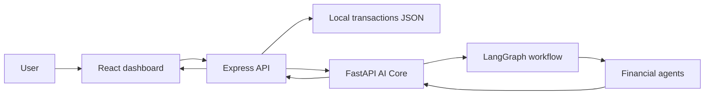
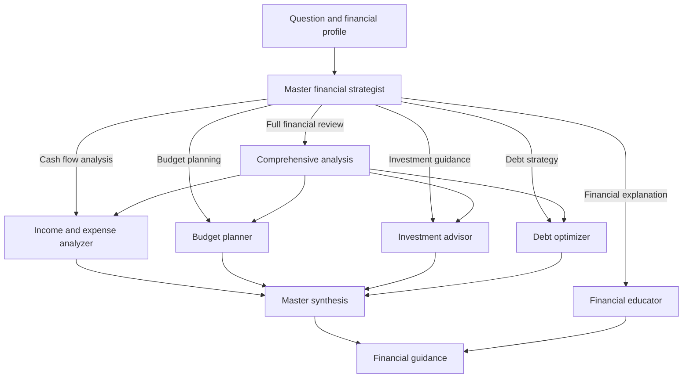

# FinWise: Personal Finance with LangGraph AI

FinWise is a focused personal-finance application for tracking everyday income and expenses, understanding cash flow, and receiving AI-assisted financial guidance. Its simple dashboard keeps the important information in one place: transaction history, income, expenses, balance, and a financial copilot.

The application combines a React interface, a lightweight Express API, local transaction storage, and a Python AI Core powered by LangGraph.

## Features

- **Income and expense tracking**: add, view, and remove transactions from one dashboard.
- **Live financial summary**: see total income, total expenses, current balance, and transaction count immediately.
- **Local data storage**: transactions are stored in `server/data/transactions.json`, making the project easy to run and inspect locally.
- **AI financial copilot**: ask questions such as “Where can I reduce spending?”, “How should I plan my budget?”, or “Which debt should I pay first?”.
- **Financial context awareness**: the API sends the copilot the current transaction list and calculated financial summary with every question.
- **Multi-agent analysis**: LangGraph routes questions to specialized financial agents or runs a complete financial review when needed.
- **Deterministic fallback guidance**: the AI Core can provide structured financial guidance even when a live LLM provider is not configured.

## Technology

| Layer | Technology | Purpose |
| --- | --- | --- |
| Web interface | React 18, TypeScript, Vite | Responsive dashboard and copilot experience. |
| API | Node.js, Express 5, TypeScript | Transaction API, local storage, financial summaries, and AI Core communication. |
| Data | Local JSON file | Stores personal transactions in a transparent, easy-to-back-up format. |
| AI service | Python, FastAPI | Receives finance context and returns structured AI analysis. |
| Agent orchestration | LangGraph | Routes each request through the right financial agents and combines their output. |
| LLM providers | Gemini and supported compatible providers | Optional natural-language narrative generation. |

## Project structure

```text
AI-agent-for-personal-finance/
├── client/                 React + Vite dashboard
│   └── src/
│       ├── App.tsx         Main finance dashboard and copilot UI
│       └── index.css       Responsive interface styling
├── server/                 Express API
│   ├── src/
│   │   └── simpleServer.ts Transaction and AI proxy endpoints
│   └── data/               Local transaction data (created at runtime)
├── server/AI_Core/         Python LangGraph AI service
│   ├── agents/             Financial specialist agents
│   ├── graph/              LangGraph workflow and shared state
│   ├── tools/              Financial calculations and plan building
│   └── api_service.py      FastAPI service entry point
└── README.md
```

## How FinWise works

1. You add an income or expense in the browser.
2. The React app sends the transaction to the Express API.
3. The API saves the transaction locally and returns the updated summary.
4. When you ask the copilot a question, the API sends your question and financial context to AI Core.
5. LangGraph selects the best specialist agent, or runs a complete multi-agent analysis.
6. The resulting guidance is returned to the dashboard.



## LangGraph multi-agent workflow

The AI Core uses a LangGraph `StateGraph` defined in [workflow.py](server/AI_Core/graph/workflow.py). Each request starts with the master agent, which determines the type of financial help required. LangGraph then follows a conditional edge to the appropriate specialist node.

For broader financial questions, LangGraph runs a comprehensive analysis that calls the income/expense, budget, investment, and debt agents before a final synthesis step.



### Agents used

| Agent | What it does |
| --- | --- |
| **Master Financial Strategist** | Reads the question, identifies the analysis type, routes work through LangGraph, and combines specialist output into a practical response. |
| **Income and Expense Analyzer** | Reviews transactions, calculates cash flow, finds spending patterns, and highlights possible pressure points. |
| **Budget Planner** | Creates a spending and savings plan based on income, expenses, goals, and financial priorities. |
| **Investment Advisor** | Produces educational, risk-aware investment guidance using the supplied financial profile. |
| **Debt Optimizer** | Evaluates debts and recommends a repayment approach, such as avalanche or snowball, based on balances and interest rates. |
| **Financial Educator** | Explains financial concepts in plain language when the user asks a learning-oriented question. |

### How an agent response is created

Each AI request contains the user’s question, transactions, income, expenses, balance, savings estimate, debt details, goals, risk tolerance, and time horizon. The master agent classifies the request and LangGraph carries the shared state between nodes. Specialist agents use that state to calculate insights. For analysis requests, the master synthesis node turns the individual results into a single action-oriented financial plan.

The response can include a summary, key insights, suggested next steps, priorities, and a workflow trace showing which agents participated.

## Running locally

### Prerequisites

- Node.js 18 or later
- Python 3.11 or later for AI features
- An optional LLM provider API key for live AI narratives

From the project root, these shortcuts are also available:

```powershell
npm run dev:server
npm run dev:client
npm run build
npm run check
```

### 1. Start the Express API

```powershell
cd server
npm ci
npm run dev
```

The API runs on `http://localhost:3000`. Visit `http://localhost:3000/health` to confirm it is ready.

### 2. Start the LangGraph AI Core

```powershell
cd server/AI_Core
python -m venv .venv
.\.venv\Scripts\Activate.ps1
pip install -r requirements.txt
uvicorn api_service:app --host 127.0.0.1 --port 8001
```

To enable a live provider, create `server/AI_Core/.env`:

```env
GEMINI_API_KEY=your_api_key_here
```

The AI Core also supports provider configuration such as `LLM_PROVIDER` and `LLM_MODEL`. See [settings.py](server/AI_Core/config/settings.py) for the available provider keys and defaults.

### 3. Start the React dashboard

```powershell
cd client
npm ci
Copy-Item .env.example .env
npm run dev
```

Open `http://localhost:5173` in your browser.

## API reference

| Method | Endpoint | Purpose |
| --- | --- | --- |
| `GET` | `/health` | Returns API status and configured AI Core URL. |
| `GET` | `/api/transactions` | Returns all transactions and the current financial summary. |
| `POST` | `/api/transactions` | Saves a transaction with `description`, `amount`, `kind`, and `date`. |
| `DELETE` | `/api/transactions/:id` | Removes a transaction. |
| `POST` | `/api/ai/analyze` | Sends a `question` and current financial context to the LangGraph AI Core. |

Example transaction request:

```json
{
  "description": "Monthly salary",
  "amount": 65000,
  "kind": "income",
  "date": "2026-09-01"
}
```

## Quality checks

The current simplified application has been verified with:

```powershell
cd server
npm run check

cd ../client
npm run build
```

The API health endpoint and transaction create/delete flow were also smoke-tested locally.

## Financial guidance notice

FinWise helps organize financial data and generate educational guidance. Review recommendations carefully before making financial, investment, tax, or legal decisions.
